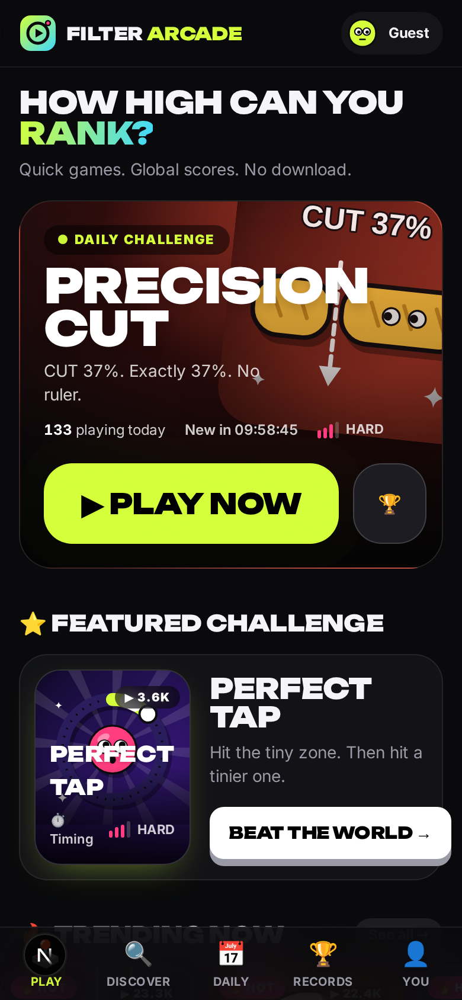
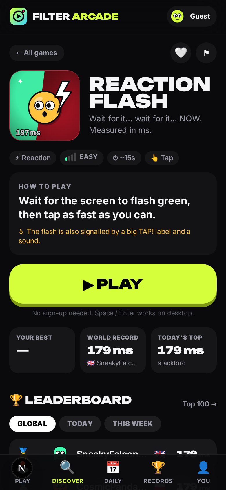
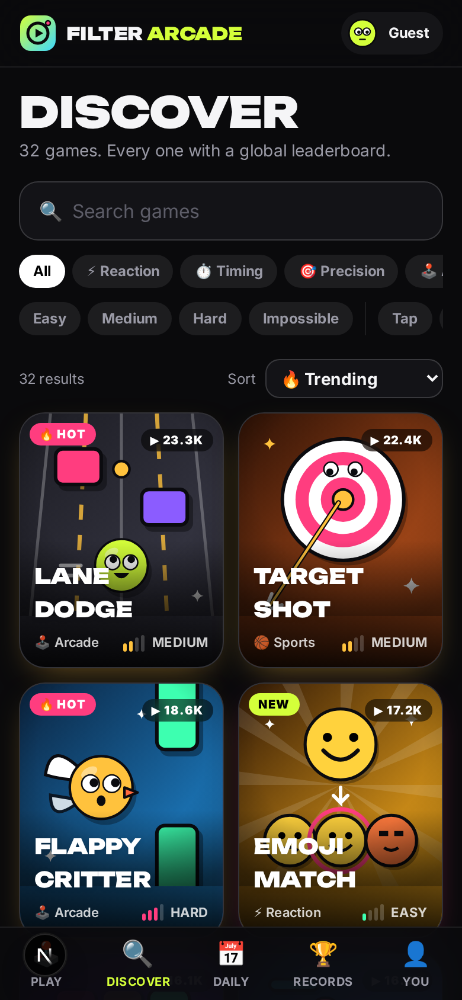
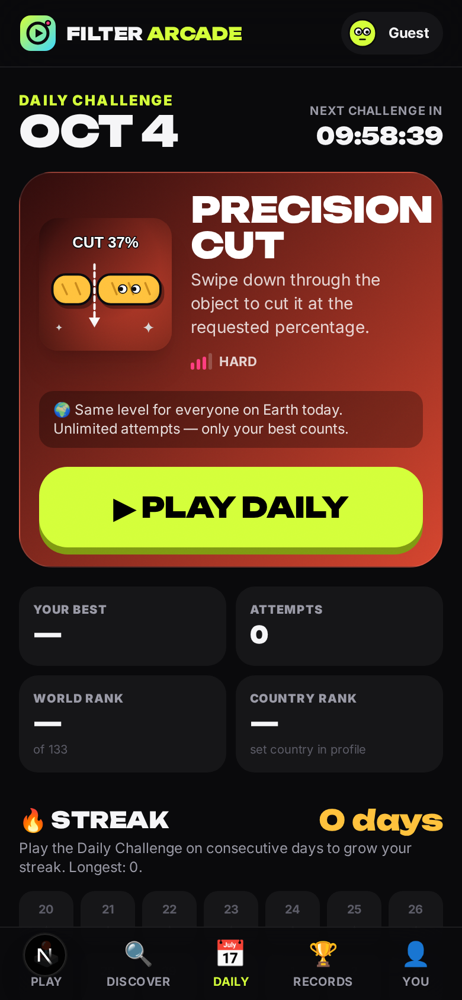

# FILTER ARCADE

**Viral filter-style mini-games, turned into a real competitive arcade.**
32 instantly playable browser games, global / daily / weekly / country / friends leaderboards, daily challenges, friend challenge links, share cards, XP, achievements, an admin panel and anti-cheat — mobile-first, installable, no sign-up required.

<p>
  
  
  
  
</p>

> The working name **FILTER ARCADE** lives in one file (`src/lib/brand.ts`). See [Rebranding](#rebranding).

---

## Contents

- [Quick start](#quick-start)
- [Scripts](#scripts)
- [Architecture](#architecture)
- [Environment variables](#environment-variables)
- [Supabase setup](#supabase-setup)
- [Database & migrations](#database--migrations)
- [Seed data](#seed-data)
- [Deployment](#deployment)
- [**How to add a new game in under 15 minutes**](#how-to-add-a-new-game-in-under-15-minutes)
- [The game runtime contract](#the-game-runtime-contract)
- [How leaderboards work](#how-leaderboards-work)
- [How score validation works](#how-score-validation-works-anti-cheat)
- [How daily challenges work](#how-daily-challenges-work)
- [How challenge links work](#how-challenge-links-work)
- [How camera games work](#how-camera-games-work)
- [How microphone games work](#how-microphone-games-work)
- [Players, XP & achievements](#players-xp--achievements)
- [Trending, analytics & admin](#trending-analytics--admin)
- [Feature flags & monetization](#feature-flags--monetization)
- [Privacy (GDPR)](#privacy-gdpr)
- [Performance & accessibility](#performance--accessibility)
- [Testing](#testing)
- [Game library](#game-library)
- [Design decisions](#design-decisions)
- [Rebranding](#rebranding)

---

## Quick start

Requirements: **Node 22+**. Nothing else — no Docker, no database server, no accounts.

```bash
npm install
cp .env.example .env.local
npm run dev            # http://localhost:3000
```

Without `DATABASE_URL` the app runs on **PGlite** (real Postgres compiled to WASM) stored in `.data/pglite`. Migrations apply automatically and, with `AUTO_SEED=true`, the database is filled with ~360 players, ~18k runs and 15 days of daily challenges on first start so leaderboards look alive.

Admin panel: <http://localhost:3000/admin> — secret `dev-admin` (from `ADMIN_SECRET`).

## Scripts

| Command | What it does |
|---|---|
| `npm run dev` | Next.js dev server (Turbopack) |
| `npm run build` / `npm start` | Production build / server |
| `npm run lint` · `npm run typecheck` | ESLint (incl. React Compiler rules) · `tsc --noEmit` |
| `npm test` | Vitest: unit + DB integration (in-memory Postgres) + render tests |
| `npm run test:e2e` | Playwright mobile flows (390×844) against a production build |
| `npm run db:migrate` | Apply `supabase/migrations/*.sql` to `DATABASE_URL` or local PGlite |
| `npm run db:seed` | Insert development data (refuses in production) |
| `npm run db:unseed` | Remove all seeded players and their data |
| `npm run db:reset` | Wipe local PGlite, migrate, seed |
| `npm run new-game -- <slug> "<Name>" [category]` | Scaffold + register a new game |

## Architecture

```
Browser                                    Server (Next.js route handlers)              Postgres (Supabase / PGlite)
───────                                    ─────────────────────────────                ──────────────────────────
Static, CDN-cached pages ──────────────▶   /games/[slug], /games/<category>, /art/*.svg  (registry only — no DB at build)
Game page ─ lazy import(game chunk) ─▶ CanvasGame runtime (one chunk per game)
   PLAY ─────────────▶ POST /api/runs/start   → run id + nonce + seed ───────────────▶ score_runs (status=started)
   GAME OVER ────────▶ POST /api/runs/submit  → validate → bests, ranks, XP, achievements ▶ personal_bests / period_bests
   results screen ◀── rank, tier, PB, XP, next target                                     daily_challenge_scores, …
   CHALLENGE ────────▶ POST /api/challenges   → /challenge/<token> (+ OG image)
   analytics ────────▶ POST /api/events (sendBeacon, batched) → analytics_events + game_daily_stats rollups
```

```
src/
  app/                    routes (pages + /api route handlers), OG images, manifest, sitemap
  components/             platform UI — play/ (game shell), leaderboard/, game/, home/, admin/, player/…
  games/
    core/                 engine.ts (CanvasGame), types.ts (contract), fx, draw, audio, haptics,
                          rng (seeded), art-kit (SVG thumbnails), camera.ts, mic.ts
    <slug>/               meta.ts (definition + BALANCE), game.ts (runtime), art.ts (SVG)
    registry.ts           THE registry — one import + one array entry per game
    taxonomy.ts           categories / collections / difficulty labels
    planned.ts            second-wave definitions (hidden placeholders)
  lib/
    db/                   driver (PGlite | postgres.js), migration runner, local Supabase shim
    auth/                 signed session cookie, Supabase identity linking
    players/              profiles, usernames, avatars, records, GDPR export/delete
    runs/                 start/submit service (the scoring transaction)
    security/             run validation (shared client+server), rate limiting
    leaderboards/         board queries, composition (top + "…" + you), rank tiers
    daily/ challenges/ achievements/ xp/ analytics/ config/ home/ admin/ og/
    client/               browser helpers (api, local progression, analytics, hooks, recorder)
    seed/                 development seed (is_seed rows only)
supabase/migrations/      plain SQL migrations (Supabase CLI compatible)
tests/unit, tests/e2e     Vitest + Playwright
```

**Data flow principles**

- Pages are static wherever possible: game pages, category pages, leaderboard shells, art and OG images are generated at build from the registry. Live numbers (records, boards, PBs) are fetched client-side.
- The browser never writes to the database directly. RLS gives browsers **read-only** access to public tables; every write goes through validated route handlers that connect with a privileged role.
- Every game is its own JS chunk, loaded only on its game page (and pre-warmed while the player reads the instructions).

## Environment variables

| Variable | Required | Purpose |
|---|---|---|
| `NEXT_PUBLIC_SITE_URL` | prod | Canonical URLs, share links, OG images |
| `DATABASE_URL` | prod | Postgres connection string. Supabase: use the **transaction pooler** (port 6543) on serverless |
| `DATABASE_POOL_MAX` | – | postgres.js pool size (default 5) |
| `PGLITE_DATA_DIR` | – | Local DB directory when `DATABASE_URL` is unset (`memory://` = throwaway) |
| `AUTO_SEED` | – | Seed an empty local DB on first start (dev only) |
| `SESSION_SECRET` | **prod** | HMAC key for player session cookies. 32+ random bytes. The app refuses to start sessions in production without it |
| `ADMIN_SECRET` | – | Password for the `/admin` bootstrap login (dev default `dev-admin`; disabled in prod if unset) |
| `ADMIN_USERNAMES` | – | Comma-separated usernames promoted to admin when they link an account |
| `RATE_LIMIT_MULTIPLIER` | – | Scale all rate limits (default 1 in prod, 25 in dev) |
| `NEXT_PUBLIC_SUPABASE_URL` / `NEXT_PUBLIC_SUPABASE_ANON_KEY` | for accounts | Enables email / Google / Apple sign-in + live leaderboards |
| `SUPABASE_SERVICE_ROLE_KEY` | for deletion | **Server-only.** Deletes the Supabase auth user on account deletion. Never exposed to the browser |
| `NEXT_PUBLIC_MEDIAPIPE_WASM_URL` / `NEXT_PUBLIC_MEDIAPIPE_FACE_MODEL_URL` | – | Self-host the face-tracking runtime/model |

## Supabase setup

1. **Create a project** at supabase.com.
2. **Schema:** either `supabase link --project-ref <ref> && supabase db push` (the files in `supabase/migrations` are plain SQL), or set `DATABASE_URL` to the project's connection string and run `npm run db:migrate`.
3. **Auth providers** (Authentication → Providers): enable **Email** (magic link), **Google** and **Apple**. Add `https://<your-domain>/auth/callback` (and `http://localhost:3000/auth/callback`) to the redirect allow-list.
4. **Env:** set `DATABASE_URL`, `NEXT_PUBLIC_SUPABASE_URL`, `NEXT_PUBLIC_SUPABASE_ANON_KEY`, `SUPABASE_SERVICE_ROLE_KEY`, `SESSION_SECRET`.
5. **Realtime** (optional): migration `…_realtime.sql` adds the best tables to the `supabase_realtime` publication; leaderboards then refresh live.

How accounts work: everyone plays as an anonymous profile (signed `fa_sid` cookie). "Secure your username" signs in with Supabase Auth on the client, then `POST /api/auth/link` verifies the access token server-side and links `auth_user_id` to the profile — no progress is lost. Signing in on a second device merges that device's guest progress into the account (better bests win, runs/favourites/achievements move over).

## Database & migrations

`supabase/migrations/20261004000000_init.sql` creates:

| Table | Purpose |
|---|---|
| `profiles` (+ `public_profiles` view) | players; no email/IP ever stored |
| `games`, `game_versions` | registry mirror + admin-editable metadata; rules snapshot per version |
| `score_runs` | append-only run log with fraud signals (duration, server window, actions, peak rate, checkpoints, flags) |
| `personal_bests`, `period_bests`, `leaderboard_counts` | compact leaderboard tables (all-time / day / week) and cached sizes |
| `daily_challenges`, `daily_challenge_scores` | one row per UTC day; per-player best + attempts |
| `challenges`, `challenge_attempts` | friend challenge links and outcomes |
| `achievements`, `player_achievements`, `player_game_stats` | progression |
| `favorites`, `follows`, `ratings`, `reports` | social & feedback |
| `analytics_events`, `game_daily_stats` | raw events + per-game daily rollups |
| `rate_limits`, `security_events`, `feature_flags`, `app_config` | ops |

**RLS:** enabled on every table. `anon`/`authenticated` can only `SELECT` public data (games, boards, achievements, flags) and their own private rows (`auth.uid()`); there are **no** insert/update/delete policies for browser roles. Locally a tiny shim (`src/lib/db/shim.sql`) recreates Supabase's roles and `auth.uid()` so the same SQL runs on PGlite and plain Postgres.

The runner (`npm run db:migrate`) tracks applied files in `public._migrations`; it's used for PGlite (automatically) and any `DATABASE_URL`.

## Seed data

`npm run db:seed` (or `AUTO_SEED=true` locally) creates 360 players across 30 countries, ~18k accepted runs spread over 14 days, personal/period bests, 15 days of daily challenges with winners, follows, challenges, analytics rollups, a flagged run and two open reports (so the admin queues aren't empty).

Seed data is clearly separated: every seeded profile has `is_seed = true` and seeded runs carry the `seed` flag. `npm run db:unseed` deletes them (cascading to their data). The seed refuses to run when `NODE_ENV=production` unless `--force` is passed.

## Deployment

Recommended: **Vercel + Supabase**.

1. Create the Supabase project and apply migrations ([above](#supabase-setup)).
2. Import the repo in Vercel; set the env vars (`DATABASE_URL` → pooler URL, `SESSION_SECRET`, `NEXT_PUBLIC_SITE_URL`, Supabase keys, optional `ADMIN_SECRET`/`ADMIN_USERNAMES`).
3. Deploy. `next build` never touches the database (static pages come from the registry), so builds are reproducible.

Any Node host works (`npm run build && npm start`). PGlite is for local dev/tests only — it is a single-process file database and not suitable for multi-instance production.

Production checklist: strong `SESSION_SECRET`; `ADMIN_SECRET` unset or strong; make yourself admin via `ADMIN_USERNAMES` + sign-in; CDN in front (country header `x-vercel-ip-country` / `cf-ipcountry` is read once at profile creation).

---

## How to add a new game in under 15 minutes

The platform gives every registered game — automatically — a static SEO page (`/games/<slug>`), artwork and OG image, a full-screen shell with countdown/HUD/pause/instant retry, server-validated scoring, global/today/week/country/friends leaderboards, results screen with ranks and XP, challenge links and share cards, favourites, recent-games history, analytics, admin controls, discover/category listing and daily-challenge eligibility.

### 1 · Scaffold (1 minute)

```bash
npm run new-game -- cannon-pop "Cannon Pop" arcade
```

This creates `src/games/cannon-pop/{meta,game,art}.ts` from a working template and adds it to `src/games/registry.ts`. Open <http://localhost:3000/games/cannon-pop> — it is already playable and ranked.

### 2 · Describe it — `meta.ts` (3 minutes)

```ts
export const BALANCE = { durationS: 20, targetRadius: 40 };   // every tuning number lives here

export default defineGame({
  slug: "cannon-pop",
  name: "Cannon Pop",
  shortDescription: "One line that sells it.",               // card text (≤ 70 chars)
  instructions: "Tap the target before time runs out.",       // readable in 2 seconds
  category: "arcade",            // reaction | timing | precision | arcade | puzzle | memory | sports | physics | rhythm | camera
  difficulty: "medium",          // easy | medium | hard | impossible
  controls: ["tap"],
  estimatedDuration: 20,         // ≤ 20 → appears in "Quick Games"
  scoreDirection: "higher",      // or "lower" for times (and scoreFormat "ms"/"centiseconds")
  scoreFormat: "points", scoreUnit: "pts",
  theme: { bg: ["#101030", "#3d3dd6"], accent: "#d4ff3a", ink: "#fff" },
  validation: {                  // anti-cheat bounds — see "How score validation works"
    minDurationMs: 1000, maxDurationMs: 300_000,
    maxScore: 500, maxScorePerSecond: 6, maxActionsPerSecond: 12,
    maxScorePerAction: 1, monotonicCheckpoints: true,
  },
  milestones: { good: 20, great: 40, legendary: 70 },
  load: () => import("./game"),  // code-split runtime
  art: () => import("./art"),    // SVG thumbnail
});
```

Optional: `howTo` bullets, `tags` (extra categories), `usesCamera` / `usesMicrophone`, `accessibility`, `isNew` / `featured`.

### 3 · Write the gameplay — `game.ts` (≈10 minutes)

Extend `CanvasGame`; it already handles canvas sizing (400-unit-wide logical space), the loop, input with multi-touch guards, run metadata, juice and the lifecycle.

```ts
class CannonPop extends CanvasGame {
  protected setup() { /* build a fresh run from this.rng (seeded!) */ }
  protected update(dt: number) { /* advance; call this.finish({ reason: "TIME!" }) to end */ }
  protected render(g: CanvasRenderingContext2D) { /* draw in logical units: this.w × this.h */ }
  protected onPointerDown(p: PointerInfo) { this.addScore(1); this.juiceHit(p.x, p.y); this.sound("pop"); }
  protected hud(): HudState { return { score: this.score, timeLeft: 12.3 }; }
}
export default ((def) => new CannonPop(def)) satisfies GameFactory;
```

Toolbox: `this.rng` (seeded — **use it for anything that affects difficulty**), `this.fx` (burst, confetti, text popups, shake, flash, pulse), `this.sound(name, pitch)`, `this.ctx.haptics`, `this.stat()/statMax()` (feeds achievements & records: `perfects`, `maxCombo`, `accuracy`), `blobCritter`/`googlyEyes` (house art style), `this.finish({ completed, reason, ranked })`.

### 4 · Art — `art.ts` (1 minute)

Compose `frame(bg, body)` with `critter`, `sticker`, `eyes`, `label`, `sparkle` from `core/art-kit` (400×400 SVG). Served at `/art/<slug>.svg`; admins can override the thumbnail URL without a deploy.

### 5 · Verify

`npm test` checks every registered game automatically (metadata sanity, milestones direction, SVG validity, runtime contract). Play it, then check the leaderboard and `/admin?s=analytics`.

---

## The game runtime contract

`src/games/core/types.ts`

```ts
interface GameRuntime {
  initialize(ctx: GameContext): Promise<void> | void;  // container, seed, mode, audio, haptics, onHud, camera?, mic?
  start(): void; pause(): void; resume(): void;
  reset(seed?: string): void;                           // instant retry
  destroy(): void;
  getScore(): number;
  getRunMetadata(): RunMetadata;                        // duration, actions, peak rate, checkpoints, stats, input
  validateLocalRun(): LocalValidation;                  // same rules the server uses
  onGameOver(cb: (r: GameResult) => void): void;
}
```

`CanvasGame` implements all of it; a game could also implement the interface directly (e.g. with Phaser or WebGL) and plug into the same shell.

## How leaderboards work

- **Every board is a compact "best per player" table**, never a scan of raw runs:
  `personal_bests` (global / country / friends), `period_bests` (`day`, `week`, keyed by UTC date / ISO-week Monday), `daily_challenge_scores` (daily).
- **One index shape for both directions:** rows store `sort_score` = `score` (higher is better) or `-score` (lower is better). Every board is `ORDER BY sort_score DESC, achieved_at ASC` on an index `(game_id, [period, key,] [country,] sort_score DESC, achieved_at)`. Ties go to whoever got there first.
- **Top N** is an index range scan with `LIMIT`. **My rank** is `COUNT(*)` over the index prefix above my score. **Neighbours** are two `LIMIT 2` scans. **Board sizes** come from `leaderboard_counts`, maintained on insert.
- **"Top 10 … you"**: if you're outside the top N, the API returns top N, a gap marker and your neighbourhood (`composeBoard`).
- **Rank tiers** (`WORLD RECORD`, `TOP 10/100/1000`, `TOP 1%/10%`) only apply on boards big enough for them to mean something.
- The result screen shows where *this* score lands (world / country / today), the next player to beat and by how much.
- Friends boards use `follows`; country boards use the profile's ISO country (changed in settings updates existing best rows).

## How score validation works (anti-cheat)

Browser games can't be made cheat-proof; FILTER ARCADE makes cheating **expensive and visible**:

1. **Server-issued runs.** `POST /api/runs/start` creates a `score_runs` row with a random nonce and the **seed** (random, daily or challenge). Rate-limited per player.
2. **The client records evidence** while playing: active duration, action count, **peak actions in any 1-second window**, a timeline of score checkpoints, game stats, rejected multi-touch / too-fast inputs.
3. **`POST /api/runs/submit`** (inside a transaction with `SELECT … FOR UPDATE` on the run):
   - run exists, belongs to this player, still `started` (duplicate submissions → 409; the *same* submission retried with its idempotency key returns the original response),
   - game id + **version** match, run not expired (2 h),
   - `evaluateRun()` (shared with the client's `validateLocalRun`): integer, non-negative score; duration within bounds; fixed-length games really lasted their length; `maxScore` / human `minScore` (lower-is-better); score rate per second; peak action rate; score per action; **monotonic checkpoint progression ending at the final score**,
   - the claimed duration fits inside the **server-observed window** since the run was issued,
   - client clock skew, **checksum** (binds run id + nonce + score + duration), seed matches the issued seed, banned players.
4. Verdicts: **accepted** → boards, XP, achievements; **flagged** → stored, *not* on boards, queued in Admin → Scores for approve/reject; **rejected** → structural garbage.
5. Admins can remove any score (the player's next-best accepted run takes its place), reset boards, ban players (removes their board rows and revokes sessions). All rejections/flags/limits are logged to `security_events`.

## How daily challenges work

- One game per UTC day, chosen **deterministically** (`hash(day) mod eligible games`, no repeats within 5 days) the first time anyone asks, and stored in `daily_challenges` with a shared seed `daily-<day>-<slug>-…`. Admins can schedule specific games for future days.
- Every player gets the **same procedural level** (the seed drives all layout randomness).
- Unlimited attempts; only the best counts. `/daily` shows the countdown to the next challenge, your attempts / best / world rank / country rank, the top players, your streak and a 28-day calendar.
- **Streaks** grow when you play on consecutive UTC days (computed under a row lock to stay correct with concurrent submissions). When a new day's challenge is created, yesterday's winner is crowned (`daily_wins`).
- Camera/microphone games are never picked as the daily.

## How challenge links work

1. After a verified run, **Challenge** calls `POST /api/challenges` → a 10-character unguessable token (`/challenge/<token>`), reusing the run's seed. One link per run (idempotent).
2. The link renders a server-side page + OG image: *"Fruithy scored 47 in Stack Up. Can you beat it?"* — no account needed.
3. **Play challenge** opens `/games/<slug>?challenge=<token>&play=1`; the run starts in `challenge` mode with the **same seed**, and the HUD shows the target.
4. The result says **YOU WON** / **YOU LOST BY 3** / **DEAD HEAT**, with **Rematch**. A player's first win on a link counts towards `challenge_wins` (no farming your own links).
5. Tracked: opens (once per browser session), attempts, wins, conversions (a challenged player who sends their own challenge), plus analytics events. **Share** also creates a challenge link, so every share is a challenge.

## How camera games work

Head Catch and Blink Jump (more planned: Head Maze, Face Paddle, Header Challenge).

- Permission is requested **only after the player taps Play on a camera game**, behind an explanation screen (why, processed on-device, never recorded/uploaded, how to stop).
- `src/games/core/camera.ts` opens the front camera and lazily imports **MediaPipe Face Landmarker** (WASM + model fetched from a CDN on first use — self-hostable via env). Frames are processed in the tab; nothing leaves the device.
- Games read `ctx.camera.readFace()` → `{ x, y, mouthOpen, blink, present }` (head position is calibrated to your neutral pose at the start of each run).
- A live preview with a **● Stop camera** button is always visible during play.
- **Fallback:** if permission is denied or tracking can't load, the game offers touch controls as **practice** (`ranked: false`) — playable, but never mixed into the camera leaderboard.

## How microphone games work

Perfect Pitch (planned: Say On Beat). `src/games/core/mic.ts` opens the mic only on request and analyses an `AnalyserNode` in real time: smoothed loudness and autocorrelation pitch detection (1024-sample window, sampled every other frame). Audio is never recorded, buffered beyond one analysis window, or uploaded. Perfect Pitch accepts any octave (comfortable for every voice). Without a mic, a slider practice mode is available (unranked).

Rhythm Tap uses the Web Audio clock for both the beat (lookahead scheduler) and judging, compensating for output latency; it remains playable visually.

## Players, XP & achievements

- **Anonymous first:** the first run creates a profile with a generated name (`NeonOtter4821`), random avatar and conservatively-detected country. Local favourites/recents/PBs live in `localStorage` and merge into the account.
- **Usernames:** 3–20 chars, letters/digits/underscore, start with a letter, reserved list, profanity filter with in-word leetspeak, unique case-insensitively, change once per 7 days, live availability check.
- **XP** (`src/lib/xp/rules.ts`, editable in Admin → XP & Config): run completion (only meaningful runs ≥ 3 s, max 12 paid runs per game per day — no farming), first play of the day, new game, personal best, daily challenge, challenge win, achievements. Level curve `60·(n−1)^1.7`.
- **Achievements** are data (`src/lib/achievements/definitions.ts`): rule types `player_stat`, `run_stat`, `run_score`, `rank`, `impossible_win`, `personal_best_count`. A generic evaluator unlocks them after each run; admins can toggle and re-price them.
- **Profiles** (`/u/<username>`): level, stats, trophy cabinet, strongest scores with ranks, follow, report. **Records** (`/records`): best ranking, headline records (fastest reaction, highest stack, longest balance, highest combo, best accuracy, daily wins), all PBs with percentiles.

## Trending, analytics & admin

- **Analytics:** the client batches events via `sendBeacon` to `/api/events` (only whitelisted client events — starts/completions/challenges are recorded server-side so they can't be spoofed). Each event bumps `game_daily_stats` rollups. Tracked: impressions, opens, starts, completions, fails, retries, duration, scores, PBs, shares, challenge created/opened/attempted, favourites, ratings, signup-after-play, camera/mic denials, submit failures.
- **Trending** (`src/lib/analytics/trending.ts`): recency-decayed (half-life 1.5 days) plays, shares, challenges and favourites + unique players in 24 h + replay and completion rates (confidence-weighted). All weights editable in Admin.
- **Admin** (`/admin`): Overview (plays today, unique players, new players/accounts, games per player, retry rate, shares, challenge links + conversion, daily participation, 7-day chart, most played, fastest growing) · Games (enable, feature, trending, new, category, difficulty, thumbnail) · Players (search, ban, admin role) · Scores (flagged queue, per-game moderation, resets) · Daily (schedule) · Reports · Analytics per game (plays, uniques, avg/median session, retry/completion/share/challenge rates, D1 return proxy, score distribution) · Achievements · Feature flags · XP/trending/ad config.
- Access: a profile with `role = 'admin'` (via `ADMIN_USERNAMES` + sign-in, or promoted by another admin) **or** the `ADMIN_SECRET` login. Every `/api/admin/*` call re-checks access.

## Feature flags & monetization

Flags (`src/lib/config/flags.ts`, toggled in Admin): `cameraGames`, `micGames`, `friendSystem`, `achievements`, `videoRecording`, `ratings`, `ads`, `multiplayer`, `dailyChallenge`.

Monetization is prepared but **off**: `shouldShowInterstitial()` never fires during gameplay, never in a player's first 10 runs, at most every 6 completed runs and 4 minutes. The slot lives on the result screen (`components/monetization`). Gameplay clip recording (`lib/client/recorder.ts`, `canvas.captureStream()` + `MediaRecorder`, on-device) is ready behind `videoRecording`.

## Privacy (GDPR)

- One essential cookie (`fa_sid`, signed player id). No tracking cookies; preferences in `localStorage`.
- No email (lives in Supabase Auth only), no IP addresses (rate-limit keys use a salted hash and expire within 48 h), country stored as a 2-letter code only.
- Camera/mic: explicit opt-in, explained, processed locally, never recorded or uploaded, stoppable any time.
- **Export** (`/api/me/export`) and **hard delete** (`DELETE /api/me`, cascades + removes the Supabase auth user; analytics anonymised) from the profile page. Privacy and terms pages included; a cookie-settings panel is anticipated in the privacy page if non-essential cookies are ever added.

## Performance & accessibility

- Homepage: server-rendered with no game code — ≈190 KB gzipped first-load JS, of which ≈155 KB is the React/Next runtime. Thumbnails are tiny static SVGs. Game pages are static HTML; each game is its own ≈7 KB gzipped chunk (engine included), pre-loaded while the instructions are read; the game registry (≈20 KB) loads only on game pages; camera/mic/MediaPipe/Supabase code loads only when used.
- Instant retry: the next server run is requested while the result screen is shown; the countdown is 1.3 s.
- 60 fps target: fixed 400-unit logical canvas with DPR ≤ 2, capped particle counts, pitch detection every other frame.
- Gameplay locks scrolling (`touch-action: none`, overscroll off), pauses on tab hide, supports touch, mouse and keyboard (Space/Enter/arrows; Esc pauses; R retries).
- Reduced motion disables shake/zoom and trims particles; all icons/buttons have labels; difficulty shows bars + text; rules never rely on colour alone, and games that do (Odd One Out) say so; sound-dependent games state it. Charts have table views.
- PWA: manifest, icons (incl. maskable), standalone, service worker offline shell (`/offline`), offline score queue with honest messaging ("Score saved locally — leaderboard unavailable").

## Testing

```bash
npm test          # 120+ tests
npm run test:e2e  # Playwright, 390×844, production build, fresh database
```

- **Unit:** run validation (both directions, fixed-length, progression, checksum), XP + anti-farming, achievements, daily selection/cooldown/streaks, leaderboard composition + tiers, trending, usernames/profanity, countries, seeded RNG, monetization policy.
- **Integration (real Postgres via in-memory PGlite):** anonymous profile creation, accept/flag/reject, idempotency + duplicate runs, ownership & version checks, leaderboard ordering (higher/lower, ties, country, today/week, friends, top-10 + gap + neighbourhood), challenge links (same seed, won/lost by N, no farming), daily flow (attempts, best, rank, streak, XP).
- **Registry:** every game has complete metadata, valid SVG art and a runtime implementing the contract.
- **Render:** game card, leaderboard (medals, gap, "you"), result screen (world rank, tiers, challenge/offline states), share cards in every format.
- **E2E:** homepage → discover → play → world rank → challenge link → retry → leaderboard → a second player opens the challenge and gets YOU WON / LOST; false start in Reaction Flash; daily/records/profile/admin; SEO + PWA endpoints.

## Game library

**32 playable games**

| | | | |
|---|---|---|---|
| Perfect Tap · timing | Tap Rush · reaction | Stop The Bar · timing | Nail Hit · timing |
| Safe Tile · reaction | Impossible Grid · puzzle | Rope Drop · physics | Balance Bar · precision |
| Stack Up · arcade | Precision Cut · precision | Pop Rush · reaction | Reaction Flash · reaction (ms, lower wins) |
| Lane Dodge · arcade | Platform Hop · arcade | Flappy Critter · arcade | Gravity Flip · arcade |
| Keep It Up · sports | Target Shot · sports | Basket Flick · sports | Memory Flash · memory |
| Odd One Out · puzzle | Emoji Match · reaction | Path Draw · precision | Physics Drop · physics |
| Perfect Hold · timing | Quick Math · puzzle | Falling Dodge · arcade | Catch Rush · arcade |
| **Head Catch · camera** | **Blink Jump · camera** | **Perfect Pitch · mic** | Rhythm Tap · rhythm |

**Second wave (defined, hidden until built — no platform changes needed):** Tiny Gap, Pattern Rush, Word Rush, Rank Ten, Impostor Party, Merge Drop, Traffic Gap, Sound Guess, Say On Beat, Face Paddle, Head Maze, Header Challenge, Goal Timing, Target Keeper, Daily Trivia Sprint, Hue Shift (the brief's "Color Switch", renamed to avoid an existing trademark).

**Difficulty philosophy:** *Easy* — most players survive 15–30 s. *Medium* — skill shows fast. *Hard* — most fail quickly but know why. *Impossible* — brutally hard, always fair. Procedural levels are seeded and carry fairness guarantees (e.g. Lane Dodge always leaves a reachable lane, Flappy gaps never jump more than a reachable height, Gravity Flip spaces side-switches beyond flip time, Platform Hop gaps stay below max jump height, Basket Flick uses fixed-time arcs so swipe length reliably maps to distance).

## Design decisions

- **Custom canvas engine instead of Phaser 3.** Phaser would add ~350 KB gzipped to every game page; the shared `CanvasGame` core is a few KB and gives us exactly what these one-mechanic games need (loop, input guards, juice, metadata for anti-cheat). The runtime contract is engine-agnostic: a Phaser or WebGL game can implement `GameRuntime` and plug into the same shell.
- **PGlite for local dev/tests.** The exact production SQL (migrations, RLS, indexes) runs with zero setup and isolated in-memory databases per test file. Production uses postgres.js against Supabase.
- **Server-side writes only.** Supabase is used for Postgres, Auth and Realtime, but browsers never write to tables; all game logic and validation lives in route handlers.
- **Static by default.** Nothing in `next build` touches the database; live data is fetched at request time or client-side.
- **Original assets only:** all art is programmatic SVG/canvas in one house style (blob critters with googly eyes); all sounds are synthesised with Web Audio; fonts (Unbounded, Inter) are OFL and self-hosted. Game names should still get a trademark check before launch.

## Rebranding

1. `src/lib/brand.ts` — name, tagline, copy, taunts, colours.
2. `src/components/brand/Logo.tsx` + `public/icon.svg` + `src/app/icons/[size]/route.tsx` — the mark.
3. `src/app/globals.css` — colour tokens (`--volt`, `--flare`, …).
4. `src/app/fonts.ts` — typefaces.
